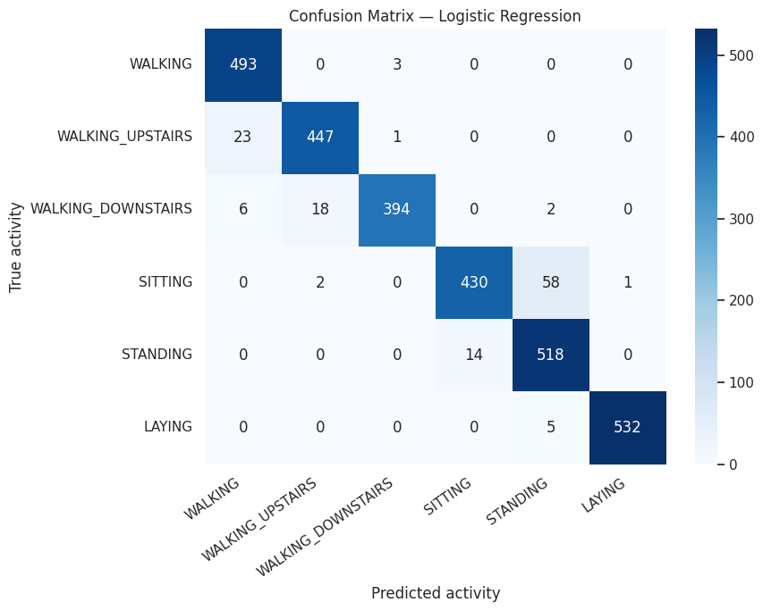

# Human Activity Recognition Using Smartphone Sensors

A reproducible notebook workflow comparing three classical classifiers for six daily activities using smartphone accelerometer and gyroscope features.

## Dataset and scope

The [UCI Human Activity Recognition Using Smartphones dataset](https://doi.org/10.24432/C54S4K) contains 10,299 windows from 30 participants, with 561 precomputed features. This project uses 7,352 training windows and 2,947 test windows from the official participant-disjoint split. Activities are walking, walking upstairs, walking downstairs, sitting, standing, and laying.

The work covers data loading, duplicate feature-name handling, exploratory analysis, training-only scaling through scikit-learn pipelines, baseline comparison, classification reports, confusion analysis, and Random Forest feature importance. Feature extraction was performed by the dataset creators.

## Recorded results

These results are retained from the supplied executed Colab notebook; the packaged copy has not been retrained locally.

| Model | Test accuracy |
|---|---:|
| Logistic Regression | 95.49% |
| RBF SVM | 95.35% |
| Random Forest (250 trees) | 92.84% |

Logistic Regression recorded macro F1 **0.9547** and weighted F1 **0.9548**, with 133 errors out of 2,947 test windows. Sitting predicted as standing accounted for 58 errors; the reverse accounted for 14.



## Run

Use Python 3.11 or newer and a virtual environment:

```bash
python -m venv .venv
# Windows PowerShell:
.venv\Scripts\Activate.ps1
# macOS/Linux: source .venv/bin/activate
python -m pip install -r requirements.txt
python -m jupyter lab
```

Open `Human_Activity_Recognition.ipynb` and run all cells in order. The notebook downloads the official archive (approximately 60 MB), including extraction of the nested archive when present. Data is stored under `data/` relative to the notebook working directory and excluded from Git. An internet connection is needed for the initial download. In Colab, upload the notebook and run all cells.

Dependencies are intentionally unpinned because the original run did not record exact package versions. A fresh execution is needed to establish a verified environment; numerical results may vary by version. No pretrained model is included.

## Evaluation limitations

The notebook ranks models using test accuracy. Therefore this is an exploratory baseline comparison, not an unbiased final evaluation after independent model selection. Scaling is fitted on training data only, but that does not remove the model-selection limitation. The official split already separates participants; future validation should group training folds by participant rather than randomly splitting overlapping windows.

The small observed accuracy gap between Logistic Regression and SVM does not establish statistical superiority. Forest impurity importance can be affected by correlated features and does not explain the Logistic Regression model. Model probabilities are not demonstrated to be calibrated. Real-time use, other devices, and other populations have not been evaluated.

## Files

- `Human_Activity_Recognition.ipynb`: portable notebook with recorded outputs and completed conclusions.
- `results/`: plots extracted from the original execution.
- `requirements.txt`: direct dependencies.
- `.gitignore`: excludes local data, environments, and model binaries.

## Dataset credit

Reyes-Ortiz, J., Anguita, D., Ghio, A., Oneto, L., & Parra, X. (2013). *Human Activity Recognition Using Smartphones*. UCI Machine Learning Repository. https://doi.org/10.24432/C54S4K.

UCI lists the dataset under CC BY 4.0. Dataset licensing is separate from licensing of this project code.
